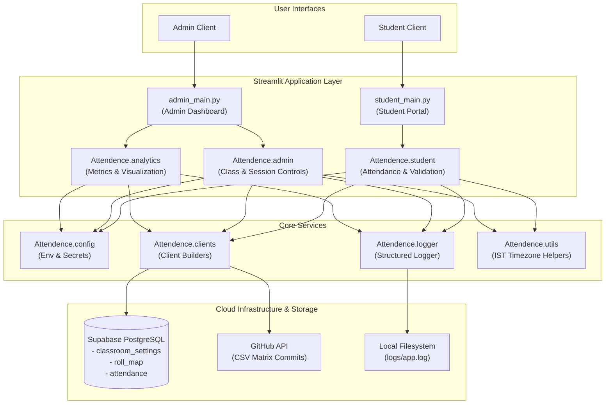

# 🧠 Smart Attendance Portal

[](https://www.python.org/)
[](https://streamlit.io/)
[](https://supabase.com/)
[](https://github.com/)
[](https://opensource.org/licenses/MIT)
[](https://github.com/PalakshiVerma/attendence-portal/pulls)

A secure, modular, cloud-connected classroom attendance tracking system built with **Streamlit**, **Supabase**, and the **GitHub API**. Features separate role-based portals for **Administrators** and **Students**, real-time passcode authentication, anti-fraud name locking, visual analytics, and automated CSV version control.

---

## 📑 Table of Contents

- [🌟 System Overview](#-system-overview)
- [✨ Key Features](#-key-features)
  - [🔐 Admin Management Dashboard](#-admin-management-dashboard)
  - [🎓 Student Attendance Portal](#-student-attendance-portal)
  - [📊 Analytics & Visual Intelligence](#-analytics--visual-intelligence)
- [🏗️ System Architecture](#️-system-architecture)
- [🗄️ Database Schema](#️-database-schema)
- [🚀 Getting Started](#-getting-started)
  - [Prerequisites](#prerequisites)
  - [Installation (using `uv` or `pip`)](#installation-using-uv-or-pip)
  - [Environment Configuration](#environment-configuration)
- [💻 Running the Applications](#-running-the-applications)
- [📁 Project Structure](#-project-structure)
- [📝 Logging & Diagnostics](#-logging--diagnostics)
- [🤝 Contributing](#-contributing)
- [📄 License](#-license)

---

## 🌟 System Overview

Traditional paper registers and static spreadsheets are slow, error-prone, and susceptible to proxy attendance. The **Smart Attendance Portal** provides a frictionless digital workflow:

1. **Admins / Instructors** open a classroom session, generate a time-bound passcode, set a daily attendance cap, and monitor real-time submissions.
2. **Students** connect without requiring complex account credentials, enter their roll number and daily passcode, and submit their attendance in seconds.
3. **Anti-Fraud Security** binds the student's name to their roll number on their first submission, preventing impersonation.
4. **Data Persistence & Auditability** stores records in **Supabase** while automatically committing timestamped attendance matrix CSVs to **GitHub** for version history.

---

## ✨ Key Features

### 🔐 Admin Management Dashboard
* **Secure Authentication**: Protected by administrative username and password credentials.
* **Class Lifecycle Controls**:
  * ➕ **Create Class**: Specify new class sections with default passcodes and daily attendance thresholds.
  * ⚡ **Single Open-Class Constraint**: Enforces that only one classroom can be active for attendance at any given time, eliminating cross-class confusion.
  * 🔄 **Dynamic Passcode & Limit Updates**: Update attendance codes and daily capacity limits on the fly.
  * 🗑️ **Permanent Deletion**: Safely delete classrooms, associated roll maps, and attendance history with `"DELETE"` confirmation.
* **Attendance Matrix & Export**:
  * 📊 **Date-Wise Pivot Table**: Instant overview of attendance status (`P` = Present, `A` = Absent) with color-coded highlighting.
  * ⬇️ **CSV Download**: Direct browser download of attendance tables.
  * 🚀 **Automated GitHub Sync**: Auto-commits timestamped CSV reports directly to the repository's `records/` folder via PyGithub.

### 🎓 Student Attendance Portal
* **Zero-Friction Access**: No prior account sign-up needed — students simply select their open class.
* **Anti-Proxy Identity Lock**:
  * On initial submission, the entered name is permanently linked to the student's roll number in the database.
  * Subsequent submissions automatically lock and autofill the verified student name.
* **Multi-Layer Submission Guards**:
  * ❌ Blocks submission if the classroom session is closed.
  * ❌ Rejects invalid or expired attendance passcodes.
  * ❌ Rejects duplicate submissions for the same student on the same date.
  * ⚠️ Blocks entries when the class daily attendance limit is reached.
* **Self-Service Attendance History**:
  * Dedicated "View My Attendance" tab allows students to inspect their personal date-wise record without exposing peers' data.

### 📊 Analytics & Visual Intelligence
* **Calculated Metrics**: Total attendance count and overall percentage calculated per student.
* **Leaderboards & Watchlists**:
  * 📈 **Top 30 Bar Chart**: Visual distribution of top attendees.
  * 🏆 **Top 3 Students**: Highlights top performers.
  * ⚠️ **Bottom 3 Students**: Identifies students needing attendance intervention.
* **Dynamic Range Filtering**: Interactive percentage slider to filter and inspect student cohorts (e.g., students below 75% attendance).
* **Summary Visualization**: Matplotlib pie chart displaying total class Present vs. Absent ratio.

---

## 🏗️ System Architecture



---

## 🗄️ Database Schema

The system uses three relational tables in **Supabase** (PostgreSQL):

### 1. `classroom_settings`
Manages classroom configurations and active session statuses.

| Column | Type | Description |
|---|---|---|
| `class_name` | `TEXT` (PK) | Unique classroom identifier (e.g., `Class 8C`, `CS-101`) |
| `code` | `TEXT` | Passcode required for student attendance submission |
| `daily_limit` | `INTEGER` | Maximum allowed attendance submissions per day |
| `is_open` | `BOOLEAN` | Session status (`true` = accepting attendance, `false` = closed) |

### 2. `roll_map`
Stores verified student identity bindings to prevent proxy attendance.

| Column | Type | Description |
|---|---|---|
| `id` | `BIGINT` (PK) | Unique autoincrement ID |
| `class_name` | `TEXT` | Classroom name |
| `roll_number` | `INTEGER` | Student's numeric roll number |
| `name` | `TEXT` | Full student name (locked on first registration) |

### 3. `attendance`
Stores individual daily attendance records.

| Column | Type | Description |
|---|---|---|
| `id` | `BIGINT` (PK) | Unique record ID |
| `class_name` | `TEXT` | Associated classroom name |
| `roll_number` | `INTEGER` | Student roll number |
| `name` | `TEXT` | Student name |
| `date` | `TEXT` / `DATE` | Submission date formatted in IST (`YYYY-MM-DD`) |

---

## 🚀 Getting Started

### Prerequisites
- **Python 3.10** or higher
- A [Supabase](https://supabase.com/) account with a database project
- (Optional) A [GitHub Personal Access Token](https://github.com/settings/tokens) with `repo` scope for auto-committing CSV reports

---

### Installation (using `uv` or `pip`)

#### Option A: Using `uv` (Recommended)
[`uv`](https://github.com/astral-sh/uv) is an extremely fast Python package manager:

```bash
# Clone the repository
git clone https://github.com/PalakshiVerma/attendence-portal.git
cd attendence-portal

# Create and activate virtual environment
uv venv
source .venv/bin/activate      # On Linux/macOS
# or .venv\Scripts\activate   # On Windows

# Install project dependencies
uv pip install -r requirements.txt
```

#### Option B: Using standard `pip`

```bash
# Clone the repository
git clone https://github.com/PalakshiVerma/attendence-portal.git
cd attendence-portal

# Create virtual environment
python -m venv venv
source venv/bin/activate      # On Linux/macOS
# or venv\Scripts\activate    # On Windows

# Install dependencies
pip install -r requirements.txt
```

---

### Environment Configuration

Create a `.env` file in the root directory (or configure `.streamlit/secrets.toml`):

```env
# ========================
# Supabase Configuration
# ========================
SUPABASE_URL=https://your-project.supabase.co
SUPABASE_KEY=your-supabase-anon-or-service-key

# ========================
# Admin Credentials
# ========================
ADMIN_USERNAME=admin
ADMIN_PASSWORD=your_secure_password

# ========================
# GitHub Sync (Optional)
# ========================
GITHUB_TOKEN=ghp_yourPersonalAccessTokenHere
GITHUB_USERNAME=PalakshiVerma
GITHUB_REPO=attendence-portal
```

> [!TIP]
> When deploying on **Streamlit Cloud**, add these values under **App Settings > Secrets**. The application seamlessly reads from both environment variables and Streamlit secrets.

---

## 💻 Running the Applications

The project includes separate entrypoints for Admin and Student workflows. Run each with `streamlit`:

### 🧑‍🏫 Run Admin Dashboard
```bash
streamlit run admin_main.py
```
* Access the portal at `http://localhost:8501`.
* Log in with your `ADMIN_USERNAME` and `ADMIN_PASSWORD`.
* Manage sessions, inspect the live matrix, trigger GitHub CSV push, or review attendance analytics.

### 🎓 Run Student Portal
```bash
streamlit run student_main.py
```
* Access the portal at `http://localhost:8501` (or the secondary port assigned).
* Students select open classes, input their roll number, and verify with the session code.

---

## 📁 Project Structure

```text
attendence-portal/
├── Attendence/                     # Core backend package
│   ├── __init__.py                 # Package exports & warning configuration
│   ├── admin.py                    # Admin panel business logic & GitHub sync
│   ├── analytics.py                # Attendance analytics, metrics & charts
│   ├── clients.py                  # Supabase & PyGithub client builders
│   ├── config.py                   # Environment variable & secrets loader
│   ├── logger.py                   # Structured console & file logging
│   ├── student.py                  # Student submission & anti-proxy logic
│   ├── supabase_client.py          # Backwards-compatible client wrapper
│   └── utils.py                    # Timezone (IST) & date formatting helpers
│
├── logs/
│   ├── .gitkeep                    # Directory preservation
│   └── app.log                     # Runtime application logs (auto-generated)
│
├── records/
│   ├── .gitkeep                    # Directory preservation
│   └── attendance_matrix_*.csv     # Auto-committed attendance matrix exports
│
├── admin_main.py                   # Streamlit entrypoint for Admin Dashboard
├── student_main.py                 # Streamlit entrypoint for Student Portal
├── pyproject.toml                  # Project configuration & build metadata
├── requirements.txt                # Pinned pip dependencies
├── versions.py                     # Diagnostic script to check installed versions
├── notes.excalidraw                # Visual architecture & design diagram
├── LICENSE                         # MIT License
└── README.md                       # Project documentation
```

---

## 📝 Logging & Diagnostics

### Centralized Logging
The system utilizes a structured logger ([`Attendence/logger.py`](Attendence/logger.py)) that streams logs simultaneously to `stdout` and `logs/app.log`.

Log entries follow this format:
```text
2026-10-30 20:15:32,891 | INFO  | Attendence.student | student.py:45 | show_student_panel() | Fetching open classes from Supabase...
2026-10-30 20:15:33,104 | DEBUG | Attendence.clients | clients.py:22 | create_supabase_client() | Supabase client initialized successfully.
```

### Dependency Diagnostics
To verify all installed package versions and check for missing modules:
```bash
python versions.py
```

---

## 🤝 Contributing

Contributions, issues, and feature requests are welcome!

1. Fork the repository.
2. Create your feature branch (`git checkout -b feat/amazing-feature`).
3. Commit your changes (`git commit -m "feat: add amazing feature"`).
4. Push to the branch (`git push origin feat/amazing-feature`).
5. Open a Pull Request.

---

## 📄 License

Distributed under the **MIT License**. See [`LICENSE`](LICENSE) for more information.
